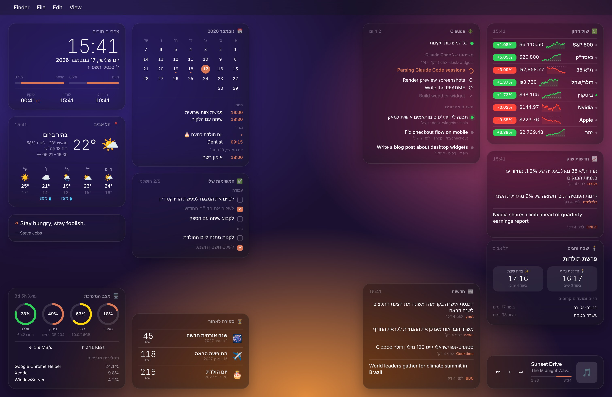

# Desk Widgets: ווידג'טים מותאמים אישית למאק

חבילה של 15 ווידג'טים לשולחן העבודה של ה-MacBook, בנויה על [Übersicht](https://tracesof.net/uebersicht/) (אפליקציה חינמית).
הכול נשלט מקובץ הגדרות אחד, `config.json`: מה מוצג, איפה, באיזה צבע ובאיזו שפה.



<sub>הצילום הוא עם נתוני דוגמה. במאק שלך יופיעו הנתונים האמיתיים. יש גם [מצב בהיר](docs/preview-light.jpg).</sub>

## מה יש בחבילה

| ווידג'ט | מה הוא מציג | מקור הנתונים |
|---|---|---|
| 🕐 **שעון** (`clock`) | שעה, תאריך לועזי ותאריך עברי, ברכה, התקדמות היום והשנה, שעונים עולמיים | המחשב |
| 📍 **מזג אוויר** (`weather`) | טמפרטורה, לחות, רוח, זריחה ושקיעה, תחזית לכמה ימים | Open-Meteo (חינמי, בלי מפתח) |
| 💹 **שוק ההון** (`market`) | מדדים, מניות, מט"ח, קריפטו וסחורות עם גרף יומי | Yahoo Finance |
| 📈 **חדשות שוק** (`marketNews`) | כותרות כלכליות: גלובס, כלכליסט, CNBC, Yahoo | RSS |
| 📰 **חדשות** (`news`) | כותרות: ynet, וואלה, Geektime, BBC | RSS |
| ✳️ **Claude** (`claude`) | סטטוס השירות של Claude, המשימות ש-Claude Code עובד עליהן עכשיו, וסשנים אחרונים | `~/.claude` + status.claude.com |
| 📅 **יומן** (`calendar`) | לוח חודשי ואירועים קרובים מאפליקציית לוח השנה | icalBuddy |
| ✅ **משימות** (`tasks`) | רשימת to-do מקובץ Markdown, לחיצה מסמנת משימה כבוצעה | `~/Documents/widget-tasks.md` |
| 🕯️ **שבת וחגים** (`shabbat`) | הדלקת נרות, צאת שבת, פרשת השבוע, חגים קרובים | Hebcal |
| ⏳ **ספירה לאחור** (`countdown`) | כמה ימים נשארו לתאריכים שחשובים לך (כולל ימי הולדת שחוזרים כל שנה) | ההגדרות שלך |
| 🖥️ **מצב המערכת** (`system`) | מעבד, זיכרון, דיסק, סוללה, מהירות רשת, תהליכים כבדים | המחשב |
| 🎵 **מתנגן עכשיו** (`nowPlaying`) | השיר הנוכחי ב-Spotify או ב-Apple Music, עם כפתורי שליטה | AppleScript |
| 💬 **ציטוט** (`quote`) | ציטוט מתחלף מרשימה שלך | ההגדרות שלך |
| 🧩 **מותאם אישית** (`custom`) | שורות שכל אחת מריצה פקודה משלך (IP, Docker, מה שתרצה) | פקודות shell |
| 📊 **טיקר** (`ticker`) | פס מניות נגלל בתחתית המסך | Yahoo Finance |

> **כבויים כברירת מחדל:** `custom` ו-`ticker`. מדליקים אותם ב-`config.json` עם `"enabled": true`.

## התקנה (3 צעדים)

**1. מתקינים את Übersicht** (אם אין לכם Homebrew, אפשר להוריד מ-[האתר](https://tracesof.net/uebersicht/)):

```bash
brew install --cask ubersicht
```

**2. מורידים את הריפו ומריצים את סקריפט ההתקנה:**

```bash
git clone https://github.com/dvir17daus-ops/-.git desk-widgets-repo
```

```bash
cd desk-widgets-repo && ./install.sh
```

הסקריפט מעתיק את הווידג'טים לתיקייה של Übersicht, יוצר קובץ משימות לדוגמה ומציע להתקין את icalBuddy (בשביל אירועי היומן).

**3. מאשרים הרשאות.** בפעם הראשונה macOS ישאל אם לאפשר ל-Übersicht לגשת ללוח השנה, לתיקיית Documents ול-Spotify/Music. מאשרים.

> 💡 Übersicht מגיע עם ווידג'ט הדגמה בשם `getting-started`. אפשר להסתיר אותו מתפריט Übersicht (האייקון בשורת התפריטים) או למחוק את הקובץ שלו מתיקיית הווידג'טים.

### לחיצות על ווידג'טים

הווידג'טים "יושבים" על שולחן העבודה, ולכן כברירת מחדל לא מגיבים ללחיצות. כדי ללחוץ (לפתוח כתבה, לסמן משימה, להחליף שיר, להמשיך סשן של Claude):
Übersicht ← **Preferences** ← **Interaction Shortcut** ← בוחרים מקש (למשל ⌘). מעכשיו מחזיקים את המקש ולוחצים.

### עדכון

```bash
git pull && ./install.sh
```

ה-`config.json` שלכם לא נדרס (גיבוי נשמר ב-`config.backup.json`).

## התאמה אישית: `config.json`

הקובץ נמצא ב:
`~/Library/Application Support/Übersicht/widgets/desk-widgets/config.json`
(או: תפריט Übersicht ← **Open Widgets Folder**). **כל שמירה מעדכנת את הווידג'טים מיד.**

> ⚠️ זה קובץ JSON: כל מחרוזת בתוך מירכאות, פסיק בין פריטים ובלי פסיק אחרי הפריט האחרון. אם נשבר משהו, כל הווידג'טים יציגו שגיאה עד שמתקנים.

### הגדרות כלליות

```jsonc
"lang": "he",            // "he" או "en": שפת הממשק
"name": "דנה",            // יופיע בברכה: "בוקר טוב, דנה"
"theme": {
  "mode": "auto",        // "auto" (לפי מצב המאק), "dark" או "light"
  "accent": "#D97757",   // צבע ההדגשה
  "width": 290,          // רוחב כל כרטיס
  "radius": 18,          // עיגול פינות
  "opacity": 0.55,       // שקיפות הרקע (0 עד 1)
  "blur": 22,            // טשטוש הרקע
  "fontSize": 13
}
```

(ההערות אחרי `//` כאן רק להסבר. אל תכתבו אותן בקובץ עצמו.)

### הגדרות שיש לכל ווידג'ט

- `"enabled": false`: מכבה את הווידג'ט.
- `"position"`: מיקום על המסך בפיקסלים, מכל פינה: `top` / `bottom` / `left` / `right`. למשל `{ "bottom": 20, "right": 20 }`.
  אפשר גם ביטויי CSS: `{ "top": 20, "left": "calc(50% - 145px)" }` למרכז המסך.
- `"width"`: רוחב משלו לווידג'ט מסוים.

> פריסת ברירת המחדל מתוכננת ל-4 עמודות ונכנסת גם במסך 13 אינץ' (1440×900). אם הוספתם הרבה פריטים ווידג'ט מתארך, הזיזו את השכן שלו או הקטינו את `maxItems`.

### דוגמאות נפוצות

**להוסיף מניה או מטבע** (`market`), לפי הסימול ב-Yahoo Finance:

```json
{ "symbol": "TSLA", "name": "טסלה" },
{ "symbol": "TEVA.TA", "name": "טבע ת\"א" },
{ "symbol": "EURILS=X", "name": "יורו/שקל" },
{ "symbol": "ETH-USD", "name": "את'ריום" }
```

סימולים שימושיים: `^GSPC` (S&P 500), `^IXIC` (נאסד"ק), `^DJI` (דאו ג'ונס), `TA35.TA` (ת"א 35), `ILS=X` (דולר/שקל), `GC=F` (זהב), `CL=F` (נפט).
מניות בבורסה בת"א מתומחרות באגורות.

**להוסיף מקור חדשות** (`news` או `marketNews`), כל פיד RSS:

```json
{ "name": "Hacker News", "url": "https://hnrss.org/frontpage" }
```

`"keywords": ["בינה מלאכותית", "AI"]` יציג רק כותרות שמכילות את המילים האלה.

**עיר אחרת למזג אוויר** (`weather`): משנים `city`, `latitude` ו-`longitude`. אם מוחקים את הקואורדינטות (`null`), העיר תאותר אוטומטית לפי השם.
אותה עיר משמשת גם לזמני השבת, אלא אם מגדירים ב-`shabbat` קואורדינטות משלו. ב-`candleMinutesBeforeSunset` שמים 40 לירושלים, 30 לחיפה ו-18 לרוב הערים.

**ספירה לאחור** (`countdown`):

```json
{ "title": "החתונה של יעל", "date": "2027-05-20", "emoji": "💍" },
{ "title": "יום הולדת לאמא", "date": "1965-03-02", "emoji": "🎂", "repeat": "yearly" }
```

**שורות מותאמות אישית** (`custom`), כל פקודת shell:

```json
{ "label": "קונטיינרים", "icon": "🐳", "command": "docker ps -q | wc -l" },
{ "label": "ענף git", "icon": "🌿", "command": "git -C ~/code/my-app branch --show-current" }
```

**שעונים עולמיים** (`clock.worldClocks`): כל אזור זמן מ[הרשימה הזו](https://en.wikipedia.org/wiki/List_of_tz_database_time_zones), למשל `"America/Los_Angeles"`.

## הווידג'ט של Claude

- **סטטוס**: נקודה ירוקה כשכל המערכות של Claude תקינות. בזמן תקלה מופיע שם התקלה (לחיצה פותחת את status.claude.com).
- **משימות של Claude Code**: רשימת המשימות של הסשן הפעיל. ⟳ = בעבודה עכשיו, ○ = ממתינה, ✓ = הושלמה.
- **סשנים אחרונים**: כותרת, פרויקט, ענף git וזמן. נקודה ירוקה מהבהבת = Claude עובד עכשיו. **לחיצה על סשן פותחת Terminal וממשיכה אותו** (`claude --resume`).

הווידג'ט רק **קורא** קבצים מ-`~/.claude`, לא משנה כלום ולא שולח כלום החוצה.

## ווידג'ט חדש משלכם

1. מעתיקים את `templates/my-widget.jsx` לתיקיית הווידג'טים ונותנים לו שם.
2. מוסיפים לו סעיף ב-`config.json` (למשל `"myWidget": { "position": { "top": 20, "left": 640 } }`).
3. משנים את `command` (פקודה או כתובת API) ואת `render` (מה להציג).

או פשוט מבקשים מ-Claude Code: *"תוסיף לחבילת desk-widgets ווידג'ט שמציג X, לפי התבנית ב-templates/my-widget.jsx"*.
אפשר גם לבקש ממנו להוסיף משימות לקובץ `~/Documents/widget-tasks.md`, והן יופיעו בווידג'ט המשימות.

## פתרון בעיות

| בעיה | פתרון |
|---|---|
| ווידג'ט מציג "טוען…" כל הזמן | בודקים חיבור לאינטרנט. תפריט Übersicht ← **Refresh All Widgets** |
| אין אירועים ביומן | `brew install ical-buddy`, ואז מאשרים ל-Übersicht גישה ללוח השנה (הגדרות מערכת ← פרטיות ואבטחה ← לוחות שנה) |
| "לא נמצא קובץ משימות" | יוצרים את `~/Documents/widget-tasks.md` (או משנים את `tasks.file`) ומאשרים גישה לתיקיית Documents |
| המוזיקה לא מופיעה | הגדרות מערכת ← פרטיות ואבטחה ← אוטומציה ← מאשרים ל-Übersicht לשלוט ב-Spotify/Music |
| לחיצות לא עובדות | מגדירים Interaction Shortcut (ראו למעלה) ומאשרים ל-Übersicht הרשאת נגישות |
| שגיאה אדומה בכל הווידג'טים | כמעט תמיד פסיק או מירכאה חסרים ב-`config.json`. אפשר לבדוק ב-[jsonlint.com](https://jsonlint.com) |
| ווידג'טים חופפים | משנים `position` או `maxItems` ב-`config.json` |

> מקורות הנתונים חינמיים וללא מפתח API. Yahoo Finance הוא ממשק לא רשמי ועלול להשתנות. אם המניות מפסיקות להתעדכן, פתחו issue.

## למפתחים

בתיקייה `dev/` יש בדיקות שמקמפלות כל ווידג'ט בדיוק כמו Übersicht (Browserify + Babel), בדיקות יחידה לפרסרים ולפקודות, וצילום תצוגה מקדימה עם נתוני דוגמה:

```bash
cd dev && npm install
```

```bash
npm test
```

```bash
npm run preview
```

מבנה החבילה: כל `*.jsx` בתיקייה `desk-widgets/` הוא ווידג'ט; קוד משותף נמצא ב-`desk-widgets/lib/` (קבצים בתיקייה בשם `lib` לא נטענים כווידג'טים).
